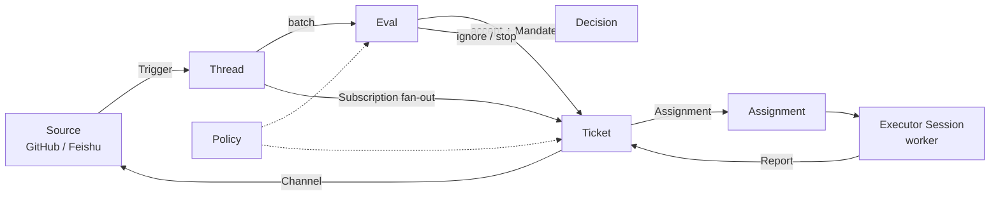

# dsh-superagent 运维手册

本手册面向在一台机器上自托管 dsh-superagent 的 operator（通常是唯一的管理员），覆盖架构、部署、健康检查、故障排查、升级回滚、安全边界和日常 checklist。

- **依据**：2026-11-02 在 Windows 11 + WSL2（Ubuntu 24.04）上的真实最小部署，以及 `reference/superagent-docs/` 中的官方文档快照（commit `6337fc8`）。
- **术语**：Source、Trigger、Thread、Eval、Ticket、Assignment、Executor、Channel、Mandate、Policy 保留英文，含义以官方 [001 Domain model](../reference/superagent-docs/001-domain.md) 为准。
- **仓库边界**：本仓库只存放本手册、`bin/preflight.sh` 和测试。执行 `scripts/dsh-superagent start|stop|status` 的控制脚本、插件源码和 profile 模板在各个部署机自己的 dsh-superagent 原型 checkout 中（后文记为 `$CHECKOUT`），不在本仓库。
- **路径约定**：`$DSH_HOME` 默认为 `$HOME/.dsh`；本文示例用 `/root/.dsh`，不要提交带个人用户名的绝对路径。`$STATE_DIR` 以 profile 配置中的 `stateDir` 为准。

---

## 1. 架构（一页）

### 1.1 工作流



一条请求的完整链路是 **Source → Trigger → Eval → Ticket → Assignment → Executor → Channel**：

1. **Source** 产生不可变的 **Trigger**。本次部署中 Source 是 GitHub（Issue 评论 @agent）或可选的 Feishu。Source 自己保存读取位置，丢弃 agent 自己的消息，并把每条 Trigger 归入 **Thread**。
2. 人的消息进入 **Eval**：gate 先判断发送者与 Policy，assessment 再判断是否开工。accept 时创建 **Ticket**，并授予 **Mandate**（Policy 版本、范围、强度、匹配规则）。
3. **Assignment** 把 Ticket 绑定到一个 **Executor** Session；Executor 在独立工作目录中执行，向 Ticket 报告 `progress / waiting / ready / blocked / failed / dropped`。
4. 结果通过 **Channel** 写回 Source：GitHub 上是评论、review thread 回复和 PR，Feishu 上是话题回复。PR 的创建与关闭本身也是 Channel 事件。
5. **Thread** 上已有 Ticket 时，后续消息通过 **Subscription** 作为上下文送到 Ticket，不再次 Eval；它是否算新工作由该 Ticket 的 Executor 按 Mandate 判断。
6. **Policy** 决定谁可以发起工作、哪些 bot 可以产生候选、主动规则和 accept mode。Policy 变更不会立即吊销已有 Mandate，但会影响恢复前的重新校验。

### 1.2 需要记住的不变量

- Source 的读取位置由 Source 自己保存；重启不能重放事件。旧事件不会因为“补通知”而回头重读。
- 一条 Trigger 只对应一个 Ticket（重复 accept 幂等）；一个 Thread 可以有多个 Ticket。
- Ticket 的状态由它自己的 Report 决定，不跟随 Executor Session 的生死；重启后 Assignment 可以重建。
- Executor 使用 `danger-full-access` 和 operator 的 OS 用户权限，wrapper 只是选择凭据，**不是隔离边界**。

---

## 2. 部署拓扑与操作顺序

### 2.1 本次部署的拓扑

| 组件 | 实际形态 | 运维要点 |
| --- | --- | --- |
| 宿主 | Windows 11（build 26200）+ WSL 2.7.8 | 原生 Windows 不可行，见故障 #1；WSL 无 systemd |
| 发行版 | Ubuntu 24.04.5，ubuntu-base rootfs，单 root 用户 | 没有 systemd，进程由 tmux 托管 |
| DSH | `@deepseek-ai/dsh` 0.2.1-rc.3，npm 全局安装 | 版本必须满足插件的 `engines.dsh` |
| 隔离 | `DSH_HOME=/root/.dsh` | 与 Windows 宿主 `~/.dsh` 完全隔离 |
| 插件 | `dsh-superagent-prototype`（commit `6337fc8`），`pnpm install && pnpm build` 后 link 进 profile `superagent` | 升级 = pull + install + build + restart |
| profile 配置 | `$DSH_HOME/profiles/superagent/cordis.patch.yml` | webserver `127.0.0.1:3082`，`stateDir` 指向 `$STATE_DIR` |
| 进程 | tmux 会话 `dsh-superagent`，内部运行 `dsh --profile superagent --no-open` | 会话名对非默认 profile 是 `dsh-<profile>` |
| state | `$STATE_DIR/orchestrator.sqlite`、`work/`、`worker-bin/`、`worker-gitconfig`、锁目录 | 升级/回滚前必须备份；`worker-bin` 与 `worker-gitconfig` 不要手工维护 |
| Source | GitHub 账号（通知驱动）+ 面板 `http://127.0.0.1:3082` | 只监听回环地址，没有公网暴露 |
| 模型 | DeepSeek API；`DEEPSEEK_API_KEY` 由宿主经 WSLENV 注入 | 不落盘；不要在日志、PR、Ticket 中输出 |

### 2.2 启动顺序

在 `$CHECKOUT` 中执行（profile 名默认 `superagent`）：

1. **准备环境**：确认 `DEEPSEEK_API_KEY` 在当前 operator shell 中非空；确认 `$DSH_HOME/profiles/superagent/cordis.patch.yml` 存在；确认没有第二个实例。
2. **启动**：
   ```sh
   scripts/dsh-superagent --profile superagent start
   ```
   `start` 在 tmux 会话 `dsh-superagent` 中拉起进程，最多等待一分钟到 runtime ready 或报出 setup 要求。重复实例会被拒绝。也可以手工在 tmux 中运行 `dsh --profile superagent --no-open`。
3. **状态**：
   ```sh
   scripts/dsh-superagent --profile superagent status
   ```
   退出码：`0` 正常；`1` 未运行/跑了两个/不响应/runtime 报错，重启可能修复；`2` 某个部件报错（如 Source、`sync:<source id>`），重启不修复；`3` 等待 setup，重启不修复。`2`/`3` 时看输出里的 `errors` 与 `setup`，不要先 restart。
4. **预检**（本仓库）：
   ```sh
   sh bin/preflight.sh
   ```
   这是只读检查，不启动、不停止、不修改任何东西。详见第 8 节。
5. **面板**：打开最新启动日志首行打印的带 token URL：
   ```sh
   ls -t "$CHECKOUT"/.artifacts/dsh-superagent-superagent-*.log | head -n 1
   ```
   token 每次启动都会变化，不要写进文档、Issue、PR 或脚本。
6. **确认闭环**：面板 Overview 无等待人工的项、无 system problems；Source 页 GitHub 为 ready；用允许名单内的账号新发一条 @agent 的评论做一次端到端验证。

### 2.3 停止与重启顺序

```sh
scripts/dsh-superagent --profile superagent stop
scripts/dsh-superagent --profile superagent restart
```

- `stop` / `restart` 请求优雅关闭，最多等待五分钟让 Executor 收尾；**不要** `kill -9`，也不要动其他 tmux 会话。
- 只有 `stop` 会写停止标记；`start` 清除它。自动恢复脚本应使用 `--respect-stop`，避免把人工停止重新拉起。
- 停止前先看 `status` 和面板 Execution 页，避免在 Executor 正在改文件/提 PR 时中断。中断本身不会丢 Ticket，重启后 Assignment 会带 recovery note 重建，但正在进行的 turn 会结束。
- 停止后确认 tmux 会话消失、端口不再响应：
  ```sh
  tmux has-session -t dsh-superagent 2>/dev/null || echo stopped
  curl -s -o /dev/null -w '%{http_code}\n' http://127.0.0.1:3082/
  ```

### 2.4 state 目录布局

| 路径 | 内容 | 是否可手工修改 |
| --- | --- | --- |
| `$STATE_DIR/orchestrator.sqlite` | Ticket、Trigger、Decision、Report、Subscription 等持久状态 | 否；只能备份/恢复，不能手改 |
| `$STATE_DIR/work/` | 每个 Ticket 一个工作目录 | 否；由 prepare 命令和 Executor 管理 |
| `$STATE_DIR/worker-bin/` | `gh`、`lark-cli`、blocked commands 的 shim | 否；非程序写入的文件会让 setup 失败 |
| `$STATE_DIR/worker-gitconfig` | agent 专用 git 配置 | 否；非程序写入的文件会让 setup 失败 |
| `$STATE_DIR/*.lock` | 实例锁 | 否 |

---

## 3. 健康检查矩阵

### 3.1 用 preflight 做例行检查

```sh
sh bin/preflight.sh          # 人类可读表格
sh bin/preflight.sh --json   # JSON 数组，供监控/自动化
sh bin/preflight.sh --help   # 用法与退出码
```

- **退出码**：`0` 全部通过或仅有 WARN；`1` 存在 FAIL；`2` 未知参数。
- **只读**：不启动/停止服务，不写系统目录，不打印任何凭据值。
- **独立**：某一项失败不会中断后续检查。
- **需从 operator shell 运行**：check 9 只看当前 shell 的 `DEEPSEEK_API_KEY`；Executor shell 会被 setup 移除含 `KEY` 的环境变量，因此从 Executor 中运行会得到预期的 FAIL。

### 3.2 检查矩阵

以下每一行都对应 `bin/preflight.sh` 的一个实际检查项（ID 即 JSON 中的 `id`）。第 8 节给出逐项语义，二者必须保持一致。

| 检查对象 | preflight 项 | 手工复核命令 | 期望结果 |
| --- | --- | --- | --- |
| 必要命令 | `required-commands` | `command -v node pnpm dsh tmux git curl` | 六个命令都有路径 |
| `DSH_HOME` | `dsh-home` | `test -d "$DSH_HOME" && test -w "$DSH_HOME"` | 存在且可写；未设置时按 `$HOME/.dsh` 检查 |
| profile 配置 | `profile-config` | `test -r "$DSH_HOME/profiles/superagent/cordis.patch.yml"` | 可读；文件不存在只记 WARN |
| stateDir | `state-dir` | `test -d "$STATE_DIR" && test -w "$STATE_DIR"` | 存在且可写；优先取 profile 的 `stateDir`，解析不到时回退 `$DSH_HOME/state/<profile>` |
| tmux 会话 | `tmux-session` | `tmux has-session -t dsh-superagent` | 退出 0；不存在为 FAIL 并提示启动方式 |
| 面板 | `panel-http` | `curl -s -o /dev/null -w '%{http_code}' http://127.0.0.1:3082/` | `200` 或 `401` 都算通过（面板需要 token，401 正常） |
| 管理 API | `management-api` | `curl -s -H 'x-orchestrator-request: 1' http://127.0.0.1:3082/orchestrator/api/state` | HTTP 200 且 body 是 JSON；缺少 header 为 403 |
| `state.health` | `state-health` | 见 3.3；只用 `python3`，不依赖 `jq` | 每个条目 `state` 为 `ready`；`error` 记 FAIL，`starting`/`paused` 记 WARN |
| 模型 key | `api-key` | `test -n "$DEEPSEEK_API_KEY"`（不要 echo） | 当前 shell 中非空；值绝不打印 |
| 磁盘 | `disk-space` | `df -Pk "$STATE_DIR"` | `Available` 大于 1 GiB（1048576 KiB） |
| GitHub Source | `state-health` 的 `github` 条目 | `GET state` 后看 `health.github`；更细状态可再看 `GET sources` | `state` 为 `ready`，`detail` 显示轮询正常 |

> GitHub Source 的细粒度状态（`GET sources` 里的 `stats`、`filtered`、`dropped`）是排障用的补充信息，不是独立的 preflight 检查项；预检对它的判定来自 `state.health.github`。

### 3.3 手工读取 `state.health`

管理 API 只监听本机，且必须带 `x-orchestrator-request: 1`：

```sh
api=http://127.0.0.1:3082/orchestrator/api
curl -sS -H 'x-orchestrator-request: 1' "$api/state" |
  python3 -c 'import json,sys; d=json.load(sys.stdin); [print(k, v.get("state"), "-", v.get("detail", "")) for k, v in sorted(d["health"].items())]'
```

期望每个条目都是 `ready`。`runtime` 是应用本身；`models` 是模型预算重试；`evals` 是最近一小时未完成的 Eval；`assessment / launch / delivery / relay / notice / reply` 是 stored work；`github / feishu / history` 是 Source；`sync:<source id>` 是允许名单同步。

查看 GitHub Source 细节：

```sh
curl -sS -H 'x-orchestrator-request: 1' "$api/sources" |
  python3 -m json.tool
```

### 3.4 面板、日志与状态脚本

- **面板**：打开启动日志首行的 URL，侧边栏选择 **Superagent**。Overview 先显示需要人的项和 system problems；Source 页显示 Source 状态、setup 问题、过滤/丢弃的 Trigger；Execution 页显示 Ticket、Pause processing 和 Retry。
- **状态脚本**：`scripts/dsh-superagent --profile superagent status` 以退出码区分 0/1/2/3（见 2.2），并把失败部件放在 `errors`、setup 要求放在 `setup`。
- **启动日志**：`$CHECKOUT/.artifacts/dsh-superagent-<profile>-<date>-<time>-<pid>.log`，默认保留最新 20 个。首行是带 token 的面板 URL，后续是启动与错误信息。日志可能包含敏感内容，不要直接贴到公开 Issue。

---

## 4. 故障排查表

前六项是 2026-11-02 真实部署中实际发生的故障；其余从官方文档推导，覆盖最常见的运行期问题。

| # | 症状 | 原因 | 处理 | 来源 |
| --- | --- | --- | --- | --- |
| 1 | 在原生 Windows 直接运行失败：路径校验、worker shim、prepare、控制脚本报错 | 源码假设 POSIX：路径 schema 以 `/` 开头，worker-bin shim 是 `#!/bin/sh`，prepare 走 `sh -c`，控制脚本用 Python `fcntl`/tmux | 不要在原生 Windows 上修配置；使用 WSL2 Ubuntu（本次为 24.04.5）。这是运行环境要求 | 部署笔记 #1 |
| 2 | WSL 内 GitHub 超时，`gh` 换 token 报 `i/o timeout`；`curl` 证书校验失败 | Windows 侧加速器（Steam++/Watt Toolkit）通过 hosts→`127.0.0.1` + 本地 MITM CA 工作；WSL 不继承 Windows 的 hosts 和证书库 | 导出 MITM 根 CA 到 WSL 信任库；在 `/etc/hosts` 把 GitHub 域名指向 Windows 宿主网关；在 `/etc/wsl.conf` 的 `[boot] command` 中按 `/proc/net/route` 动态刷新网关；最后用 `curl` 验证 200 且证书校验通过。信任 MITM CA 会降低 TLS 保证，停用加速器后应移除 | 部署笔记 #2 |
| 3 | 旧 Issue 评论 / mention 没被处理 | GitHub mention 通知晚于评论到达，Source 游标已越过该评论；旧评论不补读，这是设计而不是 bug | 重新发一条评论 @agent；不要手工改游标或伪造 Trigger | 部署笔记 #3 |
| 4 | Issue 里出现无关的“自动回复”评论，产生噪音 | operator 邮箱的自动回复被 GitHub 邮件网关转成 Issue 评论 | 关闭该邮箱对 GitHub 通知的自动回复；worker 会把无请求的消息判为 ignore，不要为它改 Policy | 部署笔记 #4 |
| 5 | worker 可以读到模型 key | worker 与编排器同 uid，可读 `/proc/<pid>/environ` | 为服务使用独立、限额、可轮换的 key；为 agent 建独立 OS 用户或容器；不要把 key 写入仓库、日志、PR。这是当前已知暴露面 | 部署笔记 #5 |
| 6 | 控制脚本按进程名匹配不到 worker，stop/status 行为异常 | node 主线程在 procps 的 `ucomm` 显示为 `MainThread` | 本地补丁把 `MainThread` 加入匹配（上游可修）；用 `ps -o pid,comm,args -p <pid>` 确认实际名称；升级后复测 stop/status | 部署笔记 #6 |
| 7 | `status` 退出 2 或 3 | 2 = 某个部件报错，重启不修复；3 = 等待 setup，重启不修复 | 退出 2：看 `errors` 中的部件和 `detail`（如 `sync:<source id>`、`github`、`reply`），修 CLI 登录、权限或 Source 配置；退出 3：看 `setup` 和面板里的修复链接。**不要**对 2/3 直接 restart | 006 |
| 8 | 在 Issue 里 @agent 后完全没有 Ticket，也没有回复 | 发送者不在允许名单；GitHub Source 关闭；处理被暂停；或通过编辑 Issue 正文添加 mention（编辑正文不会产生通知） | 检查 Policy 的 allowed 列表、Source 开关、Execution 的 Pause processing；用新评论而不是编辑正文；确认 agent 账号能读通知 | 006 / 002 |
| 9 | Ticket 失败，输出 `The prepare command failed: ...` | clone 路径错误、`git worktree` 目标已存在、权限或网络问题 | 按输出修 prepare 命令，然后在面板 Retry 该 Ticket；不要手工修改 Ticket 工作目录或伪造分支 | 006 / 003 |
| 10 | setup 报 `... was not written by dsh-superagent` | `$STATE_DIR/worker-bin` 或 `worker-gitconfig` 中有非本程序写入的文件 | 把该文件移走，或换一个 `stateDir`；不要手工维护这两个路径 | 006 |
| 11 | 升级后回滚，服务打不开数据库 | 新版本迁移过数据库；旧版本不能打开更新的 schema | 只能恢复升级前的备份；没有备份就无法降级。升级前必须备份 `orchestrator.sqlite` 与整个 state | 006 |
| 12 | 面板显示 “Failed to load plugins”，或升级后 UI 异常 | DSH 升级后运行中的实例仍加载旧 artifact | 重启运行实例；每次升级 DSH 后都 restart，并重新打开面板 | 006 |

### 4.1 排障顺序

1. `scripts/dsh-superagent status` —— 先看退出码、`errors`、`setup`。
2. `sh bin/preflight.sh` —— 快速定位命令、目录、tmux、端口、API、health、key、磁盘。
3. 最新启动日志 —— 看 runtime 启动失败、配置键错误、CLI 失败。
4. 面板 —— Overview 与 Source 页给出可操作的 setup/system problem。
5. 只有确认是 runtime 崩溃或网络瞬断，才按 2.3 重启；2/3 类问题重启无效。

---

## 5. 升级与回滚

### 5.1 升级前

1. 确认没有 Executor 正在 turn 中：面板 Execution 页，或 `status` 显示正常。
2. 记录当前版本：插件 commit、DSH 版本、profile 配置。
3. **先备份 profile 与 state**（这也是回滚的唯一依据）：
   ```sh
   # 在 $CHECKOUT 中；state_dir 以 profile 的 stateDir 为准
   state_dir=/root/.dsh/state/superagent
   scripts/dsh-superagent --profile superagent stop

   backup=$HOME/dsh-superagent-backup-$(date +%Y%m%d-%H%M%S)
   mkdir -p "$backup"
   cp -a "$DSH_HOME/profiles/superagent" "$backup/profile-superagent"
   cp -a "$state_dir" "$backup/state-superagent"
   ```
   `work/` 可能很大；至少要保证 `orchestrator.sqlite` 与 profile 完整。备份目录权限限制为 operator，不要提交到仓库。

### 5.2 升级

**插件升级：**

```sh
cd "$CHECKOUT"
git pull
pnpm install
pnpm build
scripts/dsh-superagent --profile superagent start      # 或 restart
scripts/dsh-superagent --profile superagent status
```

**DSH 本身升级：**

```sh
npm install -g @deepseek-ai/dsh@<满足 engines.dsh 的版本>
scripts/dsh-superagent --profile superagent restart
```

**升级后检查：**

1. `status` 退出 0；退出 2/3 按故障 #7 处理，不要盲目 restart。
2. `sh bin/preflight.sh` 通过，或只剩已知 WARN。
3. 面板 Settings → Prompts 中若出现 **Default updated**（默认内容已更新），逐项选择 **Keep my text** 或 **Use the new default**；不要忽略。
4. 用允许名单账号发一条新评论，确认 Issue → Ticket → PR 闭环仍然正常。
5. 检查 `state.health` 各组件 ready，Source 轮询时间在正常间隔内。

**不要**在已有 profile 上运行 `dsh superagent --from-default-profile web --dump-config`：它会替换 profile 并删除 `cordis.patch.yml` 中的机器配置。升级不使用该命令。

### 5.3 回滚

1. `scripts/dsh-superagent --profile superagent stop`。
2. 恢复 profile：
   ```sh
   cp -a "$backup/profile-superagent/." "$DSH_HOME/profiles/superagent/"
   ```
3. 恢复 state（数据库只能整体回到旧 schema；不要只替换 `orchestrator.sqlite` 而留下新的 WAL/SHM）：
   ```sh
   rm -rf "$state_dir"
   cp -a "$backup/state-superagent" "$state_dir"
   ```
4. 把插件 checkout 切回升级前 commit，`pnpm install && pnpm build`；如果回滚 DSH，先安装旧版本。
5. 启动并检查：
   ```sh
   scripts/dsh-superagent --profile superagent start
   scripts/dsh-superagent --profile superagent status
   sh bin/preflight.sh
   ```
6. 面板能打开、Overview 无 setup 问题、GitHub Source ready，才算回滚完成。

> 数据库被新版本迁移后，旧版本无法打开；没有升级前备份时，唯一安全的方向是继续使用新版本并修复问题，而不是强行降级。

---

## 6. 安全边界与最小权限建议

### 6.1 现状（必须如实理解）

- **worker 权限**：worker 与编排器以同一个 operator OS 用户运行（本次为 root），preset 为 `danger-full-access`；可以按绝对路径执行程序、读 operator 的 home。`gh`/`lark-cli` wrapper 只是选择凭据，**不是隔离边界**。
- **`/mnt/c`**：WSL 默认可读 Windows 文件系统；本次部署的 worker 能读 `/mnt/c` 下的个人文件。
- **模型 key**：`DEEPSEEK_API_KEY` 在进程环境里，同 uid 的进程可读 `/proc/<pid>/environ`。preflight 的 check 9 只检查当前 shell 是否存在，不读取、不打印 key。
- **面板**：只监听 `127.0.0.1:3082`，没有公网暴露；根路径返回 401，管理 API 必须带 `x-orchestrator-request: 1`。
- **白名单**：Policy 只允许 operator 账号发起；agent 自身消息被 Source 丢弃，不能自己给自己派活。GitHub App / `[bot]` 只能产生 inferred candidate，不能 stop Ticket。

### 6.2 最小权限建议

1. **独立 OS 用户**：给 agent 建专用用户（或容器），只授予它需要的仓库与目录；不要以 root 跑。若要彻底隔离，使用只包含 agent 凭据的独立账号/容器。
2. **收窄 `/mnt/c`**：不需要跨系统文件时，在 `/etc/wsl.conf` 设置 `[automount] enabled=false`（影响所有 WSL 访问，操作前确认），或只挂载必要目录；改完执行 `wsl --shutdown` 后验证。
3. **独立限额 key**：为服务单独申请限额、可轮换的 DeepSeek key；不写入仓库、日志、Ticket、PR；轮换后重启服务并重新跑 preflight。
4. **面板不暴露**：保持 `127.0.0.1` 绑定；远程访问用 SSH 隧道，不要改 `0.0.0.0`，不要把带 token 的 URL 发到聊天或 Issue。
5. **白名单与 bot 列表最小化**：allowed 只保留真正需要发起工作的人；bot 列表只加可信 bot；不需要的 receive-all 开关保持关闭。
6. **state 与备份**：`$STATE_DIR` 与备份目录设为仅 operator 可读（如 `0700`/`0600`）；备份不进入版本库。
7. **自动恢复需显式批准**：开机自启、定时重启都应由人明确批准；恢复脚本使用 `--respect-stop`，不要把人工 stop 重新拉起。
8. **审阅 Prompt 团队段**：Communication、Ticket scope、Delivery requirements 和 review bots 会改变 agent 的行为与合并条件；改动后按第 7 节“变更后”清单验证。

---

## 7. 检查清单

### 7.1 每日

| 项目 | 命令 / 位置 | 通过标准 |
| --- | --- | --- |
| 服务状态 | `scripts/dsh-superagent --profile superagent status` | 退出 0；2/3 按 #7 报告，不重启 |
| 预检 | `sh bin/preflight.sh`（operator shell） | 退出 0 或只剩已知 WARN；FAIL 逐项处理 |
| 面板 | 最新日志首行 URL | Overview 无等待人工项、无 system problems；能正常打开 |
| GitHub Source | 面板 Source 页 / `GET sources` | `ready`，最近轮询正常，没有堆积的 dropped message |
| tmux | `tmux has-session -t dsh-superagent` | 退出 0 |
| 管理 API | `curl -s -H 'x-orchestrator-request: 1' …/state` | HTTP 200 JSON；无 header 时 403 |
| 磁盘 | `df -Pk "$STATE_DIR"` | Available > 1 GiB，且没有异常增长 |
| 模型 key | `DEEPSEEK_API_KEY` 非空，不打印 | 服务进程与 operator shell 都有；日志/仓库中没有明文 |
| 日志 | 最新 `.artifacts` 日志 | 无持续错误；旧日志数量受控（默认 20 个） |

### 7.2 每次变更后

| 变更类型 | 必做检查 |
| --- | --- |
| 插件升级 | 备份 → pull/install/build → restart → `status`（0）→ preflight → 面板 Prompt 的 Default updated → 端到端 mention 测试 |
| DSH 升级 | 满足 `engines.dsh` → 备份 → 安装 → restart → 面板正常加载 → `status`（0）→ preflight |
| profile / `stateDir` 改动 | 先备份 profile 与 state；确认路径可写、磁盘充足；restart 后 preflight 与面板 |
| Policy / allowed / bot 列表 | 保存后 Sync now；确认 Source ready；用名单内账号做一次端到端；确认无意外过滤 |
| Source 配置 | 保存后等一次轮询；Source ready；`GET sources` 无 setup problem；必要时重发 mention |
| 凭据 / 账号 | setup check；`status`（0）；GitHub Source ready；preflight 的 api-key；轮换后确认旧 key 已撤销 |
| 网络 / TLS / WSL 配置 | `curl` 访问 GitHub 200 且证书校验通过；restart 后仍正常；记录改动的 hosts/CA 位置 |
| 安全加固（uid、`/mnt/c`、端口） | 用 worker 身份验证不能读不应读的路径；面板仍只绑回环；preflight 全绿 |
| 回滚 | 恢复 profile 与 state → 切回旧版本 → start → `status`（0）→ preflight → 面板与 Source ready |

---

## 8. `bin/preflight.sh` 参考

### 8.1 用法

```sh
sh bin/preflight.sh          # 人类可读表格
sh bin/preflight.sh --json   # JSON 数组
sh bin/preflight.sh --help   # 用法
```

环境变量：

| 变量 | 默认值 | 用途 |
| --- | --- | --- |
| `DSH_HOME` | `$HOME/.dsh` | 定位 profile 配置 |
| `DSH_SUPERAGENT_PROFILE` | `superagent` | profile 名与 tmux 会话名 `dsh-<profile>` |
| `DSH_SUPERAGENT_URL` | `http://127.0.0.1:3082` | 面板与管理 API 的 base URL；host 必须是 `127.0.0.1` 或 `localhost` |
| `DEEPSEEK_API_KEY` | 无 | 只检查存在性，绝不打印 |

JSON 数组的每个元素：

```json
{"id": "dsh-home", "status": "PASS", "detail": "...", "hint": ""}
```

`status` 只会是 `PASS`、`WARN`、`FAIL`；`hint` 仅在 WARN/FAIL 时非空。

### 8.2 十个检查项

这就是脚本执行的全部检查。表中没有列出的项目，脚本不会做。

| ID | 检查 | PASS | WARN | FAIL |
| --- | --- | --- | --- | --- |
| `required-commands` | `node`、`pnpm`、`dsh`、`tmux`、`git`、`curl` 在 `PATH` 上 | 六个都存在 | — | 列出缺失命令 |
| `dsh-home` | `DSH_HOME`（默认 `$HOME/.dsh`）存在且可写 | 存在且可写 | — | 未设置/不存在/不可写 |
| `profile-config` | `$DSH_HOME/profiles/<profile>/cordis.patch.yml` 可读 | 可读 | 文件不存在 | 存在但不可读，或 `DSH_HOME` 无法解析 |
| `state-dir` | profile 的 `stateDir` 存在且可写；读取不到时回退 `$DSH_HOME/state/<profile>` | 存在且可写 | — | 回退后仍不存在或不可写 |
| `tmux-session` | tmux 会话 `dsh-<profile>` 存在 | 存在 | — | 不存在或 tmux 未安装；hint 给出启动方式 |
| `panel-http` | 面板根路径可访问 | HTTP 200 或 401 | — | 连接失败、其他状态码或缺 `curl` |
| `management-api` | `GET /orchestrator/api/state` 带 `x-orchestrator-request: 1` | HTTP 200 且 JSON 可解析 | — | 连接失败、非 200、非 JSON、缺 `curl`/`python3` |
| `state-health` | `state.health` 每个条目 | 全部 `ready` | 有 `starting`/`paused` 等非 ready 但无 `error` | 任一 `error`、API 不可达、JSON 无法解析、health 为空 |
| `api-key` | 当前 shell 的 `DEEPSEEK_API_KEY` | 非空（只报告存在性） | — | 空或未设置 |
| `disk-space` | stateDir 所在文件系统可用空间 | 大于 1 GiB | — | 小于等于 1 GiB 或无法读取 |

### 8.3 测试

```sh
sh -n bin/preflight.sh
sh bin/preflight.sh --help
sh bin/preflight.sh --json | python3 -c 'import json,sys; json.load(sys.stdin)'
sh tests/test_preflight.sh
```

`tests/test_preflight.sh` 覆盖：`sh -n`、`--help` 退出 0、`--json` 可被 `python3` 解析且包含十个检查、未知参数非 0、真实运行退出 0/1 且不崩溃。测试使用临时目录并在退出时清理，不依赖外网；preflight 只访问 localhost。

### 8.4 脚本不做什么

- 不启动、停止、重启服务，不修改配置，不写系统目录。
- 不验证 GitHub 网络出口、模型 API 调用或实际触发一次 Ticket；这些需要按第 7 节的端到端步骤人工确认。
- 不读取服务进程的 `/proc/<pid>/environ`；`api-key` 只看当前 shell，因此从 Executor shell 运行会得到 FAIL（设计如此，见 6.1）。

---

## 附：相关文档

- [000 Philosophy](../reference/superagent-docs/000-philosophy.md)
- [001 Domain model](../reference/superagent-docs/001-domain.md)
- [002 Authorization](../reference/superagent-docs/002-authorization.md)
- [003 Execution](../reference/superagent-docs/003-execution.md)
- [004 Prompts](../reference/superagent-docs/004-prompts.md)
- [005 Panel](../reference/superagent-docs/005-panel.md)
- [006 Deployment](../reference/superagent-docs/006-deployment.md)
- [007 Architecture](../reference/superagent-docs/007-architecture.md)
- [008 Cookbook](../reference/superagent-docs/008-cookbook.md)
- 本次部署的脱敏笔记：[reference/deployment-notes.md](../reference/deployment-notes.md)
